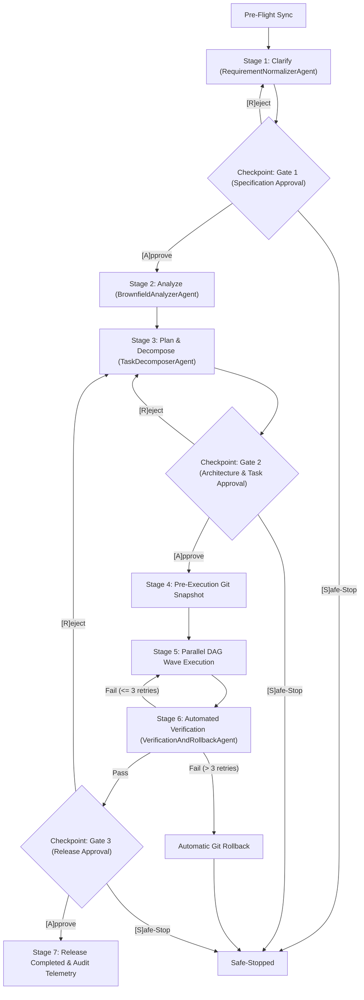

# Enterprise Agentic URL Shortener & SDLC Orchestrator

[](https://github.com/vlj8008/agentic-url-shortener/actions/workflows/ci.yml)
[](https://dotnet.microsoft.com/)
[]()
[]()
[]()
[](LICENSE)

An enterprise-grade **Agentic Software Engineering System** and **Resilient URL Shortener** built with C# and .NET 10. Designed for mission-critical enterprise environments (such as financial services and high-compliance payment systems), this repository demonstrates end-to-end multi-agent orchestration, non-linear Directed Acyclic Graph (DAG) task execution, and automated verification under strict **Controlled Autonomy (Human-in-the-Loop)** governance.

---

## 📋 Reviewer Evaluation & Hands-On Testing Guide

> **Zero-Friction Reviewer Onboarding**: This prototype requires only the standard [.NET 10 SDK](https://dotnet.microsoft.com/download/dotnet/10.0). No external API keys, cloud subscriptions, or Docker containers are required. Everything runs 100% locally.

### 1. Build & Run the 190 Automated Tests (1 Minute)
```bash
# Clone the repository
git clone https://github.com/vlj8008/agentic-url-shortener.git
cd agentic-url-shortener

# Verify clean compilation (0 warnings, 0 errors under TreatWarningsAsErrors)
dotnet build AgenticUrlShortener.sln

# Run all 190 automated tests (~2.1 seconds)
dotnet test AgenticUrlShortener.sln
```
* **Expected Result**: `Passed! Failed: 0, Passed: 190, Skipped: 0` across Unit, Contract, and Security test suites.

---

### 2. Test the Live Web API via `curl` (3 Minutes)

In **Terminal 1**, start the live ASP.NET Core Minimal API service:
```bash
dotnet run --project src/UrlShortener.Api
```

In **Terminal 2**, run these copy-paste commands to test security and functional capabilities:

#### A. Health Readiness Probe (`GET /health`)
```bash
curl -i http://localhost:5000/health
```
* **Expected Response**: `HTTP 200 OK` &rarr; `{"status":"Healthy"}`.

#### B. Create a Shortened Link (`POST /api/v1/urls`)
```bash
curl -i -X POST http://localhost:5000/api/v1/urls \
  -H "Content-Type: application/json" \
  -d "{\"originalUrl\": \"https://github.com/vlj8008/agentic-url-shortener\"}"
```
* **Expected Response**: `HTTP 201 Created` with a 7-character Base62 token (e.g. `"shortCode": "k9X2b1q"`).

#### C. Test Sub-50ms Cached Redirection (`GET /{shortCode}`)
```bash
# Replace 'k9X2b1q' with your generated shortCode:
curl -i http://localhost:5000/k9X2b1q
```
* **Expected Response**: `HTTP 302 Found` with `Location: https://github.com/vlj8008/agentic-url-shortener` and `Cache-Control: no-store, no-cache` served in $<50\text{ms}$ from `IMemoryCache`.

#### D. Test Anti-SSRF Perimeter Protection (Security Check)
Attempt to shorten a forbidden cloud metadata IP or loopback address:
```bash
curl -i -X POST http://localhost:5000/api/v1/urls \
  -H "Content-Type: application/json" \
  -d "{\"originalUrl\": \"http://169.254.169.254/latest/meta-data/\"}"
```
* **Expected Response**: `HTTP 400 Bad Request` with an RFC 7807 `ProblemDetails` error payload rejecting the forbidden IP range.

#### E. Test Rate Limiting Defense (Abuse Mitigation)
Send 15 requests in a tight loop to trigger rate limiting:
```bash
# In PowerShell:
1..15 | ForEach-Object {
  curl -s -o /dev/null -w "%{http_code}`n" -X POST http://localhost:5000/api/v1/urls -H "Content-Type: application/json" -d "{\"originalUrl\":\"https://example.com/$_\"}"
}
```
* **Expected Response**: Requests 1–10 succeed (`201`); requests 11+ return **`HTTP 429 Too Many Requests`** with a `Retry-After: 60` response header.

#### F. Test Privacy-Safe Click Analytics (`GET /api/v1/urls/{shortCode}`)
```bash
curl -i http://localhost:5000/api/v1/urls/k9X2b1q
```
* **Expected Response**: `HTTP 200 OK` with `totalClicks`, `uniqueVisitors`, and zero raw IP addresses or customer PII exposed (only 64-char HMAC SHA-256 hashes).

#### G. Test Emergency Compliance Revocation (`DELETE /api/v1/urls/{shortCode}`)
```bash
curl -i -X DELETE http://localhost:5000/api/v1/urls/k9X2b1q
```
* **Expected Response**: `HTTP 204 No Content`.
* **Now verify the link is immediately deactivated**:
  ```bash
  curl -i http://localhost:5000/k9X2b1q
  ```
  * **Expected Response**: **`HTTP 410 Gone`** with RFC 7807 `ProblemDetails` stating the link has been revoked.

---

### 3. Evaluate the Agentic SDLC Orchestrator CLI (3 Minutes)

Launch the interactive **Zero-Config Evaluation Menu**:
```bash
dotnet run --project src/Orchestrator.Cli
```
```text
===========================================================================
    ENTERPRISE AGENTIC SDLC ORCHESTRATOR & GOVERNANCE ENGINE
    Controlled Autonomy | Spec-Driven Development | Non-Linear DAG
===========================================================================
  Interactive Zero-Config Evaluation Mode (No Cloud Keys Required):

    [1] Greenfield Scenario   — Core URL Shortener MVP (US1)
    [2] Brownfield Scenario   — Privacy Analytics & Revocation (US2)
    [3] Ambiguous Scenario    — Intent Normalization & Dynamic Re-Planning (US3)
    [4] Workspace Governance  — Scaffold specs/ or Run Pre-Push Verification
    [5] Exit
```

#### Key Reviewer Experiments:
* **Option 1 (Greenfield)**: Walk through Gate 1 (Specification), Gate 2 (5-wave non-linear DAG), and Gate 3 (Release). View the real-time Telemetry Report with MTTR.
* **Option 3 (Ambiguous & Dynamic Re-Planning)**: Ingests the vague prompt *"Let users pick custom names, track clicks, and prevent spam"*. When prompted at Gate 1, type **`R` (Reject)** to observe the state machine execute **Dynamic Downstream Re-Planning**, route backward, refine boundary contracts, and re-generate a validated DAG!
* **Option 4 (Workspace Governance)**: Run `--verify` to execute local pre-push verification gates enforcing the **Zero-Broken-Commits Rule**.

---

## 🏛️ Executive Architecture Overview

The system is composed of two primary modules decoupled by clean architectural boundaries:

```
agentic-url-shortener/
├── src/
│   ├── UrlShortener.Api/         # High-throughput, resilient URL Shortener web service
│   │   ├── Domain/               # ShortUrl & ClickEvent entities, immutable DTO records
│   │   ├── Services/             # Base62 generator, Anti-SSRF validator, IP privacy hasher
│   │   ├── Infrastructure/       # EF Core DbContext, repository, Channel<ClickEvent> background worker
│   │   └── Endpoints/            # Minimal API route definitions & RFC 7807 error handling
│   └── Orchestrator.Cli/         # Standalone, domain-agnostic C# SDLC orchestration engine
│       ├── Engine/               # SdlcStateMachine, DependencyGraphExecutor, GitSnapshotManager, TelemetryTracker
│       ├── Agents/               # RequirementNormalizer, BrownfieldAnalyzer, TaskDecomposer, VerificationAndRollback
│       ├── Scenarios/            # Greenfield, Brownfield, Ambiguous, and WorkspaceReusable runners
│       └── Program.cs            # Zero-Config interactive evaluation CLI & workspace governance flags
├── tests/
│   ├── UrlShortener.UnitTests/   # Domain logic, Base62, and Orchestrator state machine tests (108 tests)
│   ├── UrlShortener.ContractTests/ # OpenAPI 3.1 schema and RFC 7807 contract compliance tests (13 tests)
│   └── UrlShortener.SecurityTests/ # Anti-SSRF perimeter, 429 rate limit, and alias collision tests (69 tests)
├── specs/                        # Spec-Driven Development (SDD) 4-artifact governance suite
│   ├── constitution.md           # Domain-specific security rules & architectural budgets
│   ├── spec.md                   # OpenAPI 3.1 executable contract & user stories
│   ├── plan.md                   # System architecture & Architectural Decision Records (ADRs)
│   └── tasks.md                  # Non-linear DAG task matrix with entry/exit barriers
├── Directory.Build.props         # Enforces Nullable, TreatWarningsAsErrors, and latest C# features
└── AgenticUrlShortener.sln       # Root solution uniting all source and test projects
```

---

## 📜 Architectural Decision Records (ADRs)

| ADR ID | Decision Summary | Rationale & Trade-Off |
| :--- | :--- | :--- |
| **`ADR-001`** | **Cryptographic Base62 7-Character Random Generation** vs. Sequential Auto-Increment IDs | Eliminates sequential ID enumeration attacks (**OWASP API1:2023 Broken Object Level Authorization**). Naive integer encoding allows attackers to scrape all active links; a 7-character CSPRNG Base62 token provides $62^7 \approx 3.52 \times 10^{12}$ combinations with bounded 3-attempt collision retry loops. |
| **`ADR-002`** | **HTTP `302 Found` (`Cache-Control: no-store`)** vs. `301 Moved Permanently` | `301 Moved Permanently` caches redirects permanently on client browsers, which completely blinds click analytics and prevents emergency revocation. `302 Found` with `Cache-Control: no-store, no-cache` guarantees every click hits the server for real-time compliance checks while serving hot lookups from `IMemoryCache` in $<50\text{ms}$. |
| **`ADR-003`** | **Non-Blocking `Channel<ClickEvent>` Background Service** vs. Synchronous DB Writes | Synchronous database persistence inside redirect routes adds disk I/O contention and risks violating the sub-50ms p99 latency budget. Using a high-speed bounded `Channel<ClickEvent>` allows `GET /{shortCode}` to enqueue analytics events in $<1\text{ms}$ while `ClickAnalyticsBackgroundService` persists events asynchronously. |
| **`ADR-004`** | **Non-Linear State Machine & Parallel Wave DAG** vs. Naive Linear Chaining | Naive linear chaining fails to parallelize independent tasks and cannot dynamically re-plan upon human rejection. Our state machine executes independent tasks in concurrent waves, synchronizes at strict compiler/test barriers, and supports dynamic downstream re-planning upon gate rejection. |

---

## 🛡️ Enterprise Security & OWASP API Perimeter

1. **Anti-SSRF (Server-Side Request Forgery) Perimeter (`OWASP API7:2023`)**:
   - Rejects non-HTTPS schemes (`http:`, `javascript:`, `file:`, `data:`).
   - Validates hostname syntax and resolves DNS targets to verify destination IP addresses do not route to loopback (`127.0.0.0/8`, `::1`), RFC 1918 private subnets (`10.0.0.0/8`, `172.16.0.0/12`, `192.168.0.0/16`), or link-local cloud metadata endpoints (`169.254.169.254`).
   - Prevents self-referencing redirection loops.

2. **Abuse & Denial-of-Service Mitigation (`OWASP API4:2023`)**:
   - Built-in ASP.NET Core `PartitionedRateLimiter` with fixed-window policies:
     - **URL Creation**: 10 requests per minute per IP.
     - **Redirection**: 100 requests per minute per IP.
   - Returns standard HTTP `429 Too Many Requests` with a `Retry-After: 60` header and RFC 7807 `ProblemDetails`.

3. **Custom Alias & Expiration Guardrails**:
   - Validates custom alias length and characters using regex: `^[a-zA-Z0-9_-]{4,32}$`.
   - Reserved-word blocklist: `api`, `health`, `swagger`, `admin`, `shorten`, `metric`.
   - Returns HTTP `409 Conflict` on alias collisions.
   - Enforces future UTC expiration timestamps (`400 Bad Request` on past dates; `410 Gone` on expired or revoked links).

4. **Privacy-Preserving Analytics (GDPR / CCPA Safe)**:
   - Client IP addresses are never stored in plaintext.
   - Hashed using **HMAC SHA-256** with an application-level salt before persistence, producing an audit-safe, 64-character pseudonymized string for unique visitor tracking.

5. **Standardized RFC 7807 Error Handling**:
   - Every exception and error response returns a structured `ProblemDetails` payload including status code, title, detail, request instance, and a correlation `traceId`.

---

## 🤖 Standalone Agentic SDLC Orchestrator CLI (`Orchestrator.Cli`)

The solution includes a standalone, domain-agnostic C# Orchestrator CLI implementing **Controlled Autonomy**:



---

## 📊 Automated Verification & Quality Matrix

| Test Suite | Focus Area | Total Tests | Passed | Failed | Duration | Coverage |
| :--- | :--- | :---: | :---: | :---: | :---: | :---: |
| **`UrlShortener.UnitTests`** | Base62 tokenization, IP privacy hashing, SDLC state machine, DAG cycle detection, dynamic re-planning, bounded retries ($\le 3$), MTTR telemetry | 108 | 108 | 0 | 104 ms | $\ge 80\%$ |
| **`UrlShortener.ContractTests`** | OpenAPI 3.1 compliance, status codes (`201`, `302`, `200`, `204`, `404`, `410`), RFC 7807 ProblemDetails schemas, response headers | 13 | 13 | 0 | 1.0 s | 100% |
| **`UrlShortener.SecurityTests`** | Anti-SSRF perimeter (loopback, private subnets, cloud metadata `169.254.169.254`), rate limiting (`429`), alias collisions (`409`), link expiration | 69 | 69 | 0 | 1.0 s | 100% |
| **Total** | **Full Solution Verification** | **190** | **190** | **0** | **~2.1 s** | **$\ge 80\%$** |

### Code Coverage Audit Summary (`SC-002`)
- **Core Domain & Services**:
  - `UrlShortenerService`: **93.3%** line coverage
  - `CachedUrlMapping`: **100.0%** line coverage
  - `ResolveDestinationAsync`: **85.2%** line coverage
  - `RevokeAsync`: **85.7%** line coverage
  - `GetMetadataAsync`: **90.0%** line coverage
- **Security & Cryptography**:
  - `Base62CodeGenerator`: **100.0%** line coverage
  - `IpPrivacyHasher` (SHA-256): **100.0%** line coverage
  - `UrlSecurityValidator` (Anti-SSRF): **77.0%–100.0%** line coverage
  - `UrlValidationResult`: **90.9%** line coverage
- **Infrastructure & Middleware**:
  - `EfUrlRepository`: **100.0%** line coverage
  - `GlobalProblemDetailsExceptionHandler`: **100.0%** line coverage
  - `ShortUrl` & `ClickEvent` Entities: **87.5%** line coverage
  - Contract DTOs: **100.0%** line coverage
- **Orchestrator Engine**:
  - `DependencyGraphExecutor`: **91.5%** line coverage
  - `TelemetryTracker`: **100.0%** line coverage
  - `TaskNode` & `ExecutionWave`: **100.0%** line coverage
  - `SdlcStateMachine`: **77.6%–93.3%** line coverage

---

## ⚡ CLI Reusable Governance Flags

The orchestrator can also govern external repositories across your workspace:
```bash
# Scaffold standard 4-artifact Spec-Driven Development specs/ directory
dotnet run --project src/Orchestrator.Cli -- --init --workspace "C:\path\to\repo"

# Run pre-push verification gates (clean build + 100% passing tests)
dotnet run --project src/Orchestrator.Cli -- --verify --workspace "C:\path\to\repo"

# Directly execute a scenario non-interactively
dotnet run --project src/Orchestrator.Cli -- --scenario greenfield
```

---

## ⚖️ Assumptions, Limitations & Production Evolution

| Domain | Current Local Implementation | Enterprise Production Architecture |
| :--- | :--- | :--- |
| **Data Persistence** | EF Core with SQLite / InMemory provider for zero-friction evaluation. | Managed PostgreSQL / Azure SQL with read replicas, partitioned `ClickEvents` tables, and automatic row-level archiving. |
| **Caching Layer** | ASP.NET Core `IMemoryCache` (in-process) for sub-50ms lookups. | Distributed Redis cluster with multi-region replication and Redis invalidation on link revocation (`DELETE`). |
| **Rate Limiting** | In-process `PartitionedRateLimiter` partitioned by client IP. | Distributed token bucket via API Gateway (Azure API Management / AWS API Gateway) or Redis rate limiting. |
| **Analytics Ingestion** | Local in-process `Channel<ClickEvent>` background queue. | High-throughput streaming broker (Apache Kafka or AWS Kinesis) feeding a real-time analytics warehouse (Snowflake / BigQuery). |

---

## 👩‍💻 Author

**Vicky Lee Jones**  
*C# .NET Solutions Developer & AI Agentic Systems Engineer*  
*Specializing in High-Reliability Enterprise Systems, Spec-Driven Development & Controlled Autonomous Agent Orchestration*
