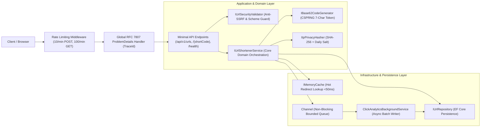
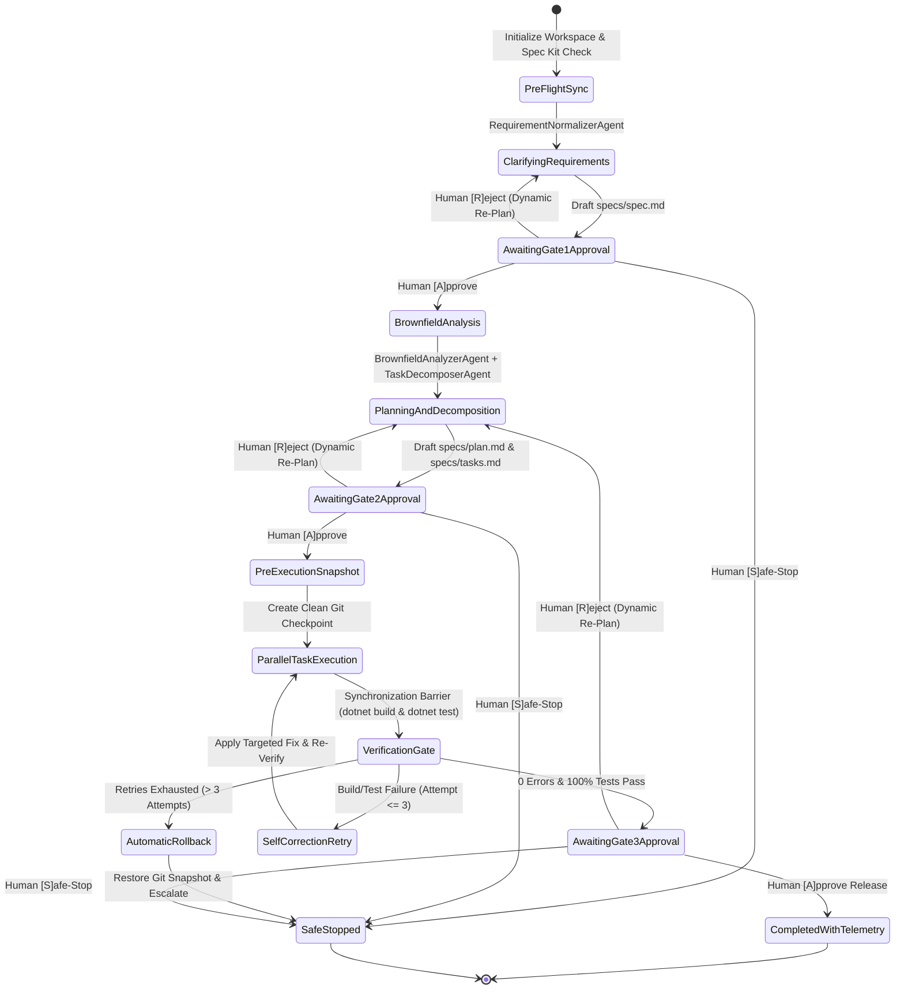

# Implementation Plan: Enterprise Agentic URL Shortener & SDLC Orchestrator

**Branch**: `spec/plan-md` | **Date**: 2026-11-04 | **Spec**: [`specs/spec.md`](./spec.md)  
**Input**: Feature specification from [`specs/spec.md`](./spec.md) and domain guardrails from [`specs/constitution.md`](./constitution.md)

---

## 1. Executive Summary

This implementation plan translates the Gate 1 approved specification ([`specs/spec.md`](./spec.md)) into a production-grade C# / .NET system architecture comprising two decoupled, modular applications:

1. **The Target Application — `UrlShortener.Api`**: An ASP.NET Core Minimal API service enforcing 7-character cryptographic Base62 short code generation, multi-stage Anti-SSRF validation, sub-50ms p99 redirection via `IMemoryCache`, non-blocking privacy-safe click analytics via `System.Threading.Channels`, per-client sliding-window rate limiting, and RFC 7807 `ProblemDetails` error handling.
2. **The Agentic Engineering System — `Orchestrator.Cli`**: A domain-agnostic, non-linear stateful SDLC orchestration CLI that coordinates 4 specialized autonomous agents across Greenfield, Brownfield, and Ambiguous scenarios. It enforces human-in-the-loop checkpoints (`[A]pprove / [R]eject / [S]afe-Stop`), pre-execution Git snapshots, bounded self-correction retries ($\le 3$) with automatic rollback, dynamic downstream re-planning, and audit-grade reliability telemetry.

---

## 2. Technical Context

| Dimension | Selected Technology / Standard | Architectural Justification |
| :--- | :--- | :--- |
| **Language & Runtime** | C# 13 / .NET 9.0 (compatible with .NET 8.0+) with `<Nullable>enable</Nullable>` and `<TreatWarningsAsErrors>true</TreatWarningsAsErrors>` | Enforces compile-time null safety, immutable `record` DTOs, high-performance native async I/O, and zero-warning build hygiene. |
| **Web Framework** | ASP.NET Core Minimal APIs | Low-ceremony, high-throughput routing with native endpoint filters, OpenAPI 3.1 metadata support, and built-in dependency injection. |
| **Caching & Concurrency** | `Microsoft.Extensions.Caching.Memory` (`IMemoryCache`) + `System.Threading.Channels.Channel<T>` | Achieves sub-50ms p99 redirect latency on read paths while decoupling analytics database writes onto a non-blocking background consumer (`IHostedService`). |
| **Persistence** | Entity Framework Core (`Sqlite` / `InMemory` configurable provider) | Zero external container/cloud setup friction for reviewers out of the box (`dotnet test` / `dotnet run`), while enforcing parameterized queries and `.AsNoTracking()` read hygiene. |
| **Security & Resiliency** | `System.Security.Cryptography.RandomNumberGenerator`, `SHA256`, `System.Threading.RateLimiting` | Native Base Class Library (BCL) cryptography and sliding-window rate limiting with zero third-party supply-chain risk. |
| **AI Orchestration** | `Microsoft.Extensions.AI` Abstractions (Dual-Mode: Zero-Config Deterministic + Live LLM Provider) | Decouples the state machine from specific AI vendors, enabling 100% deterministic local reviewer evaluation or live cloud LLM execution via environment variables. |
| **Automated Testing** | `xUnit`, `Microsoft.AspNetCore.Mvc.Testing` (`WebApplicationFactory`) | Supports fast unit tests, full in-memory HTTP pipeline integration/contract tests, and security boundary verification targeting $\ge 80\%$ coverage. |

---

## 3. Constitution Check (Pre-Implementation Gate)

*Every principle from [`specs/ENGINEERING_CONSTITUTION.md`](./ENGINEERING_CONSTITUTION.md) and [`specs/constitution.md`](./constitution.md) is verified below prior to task decomposition:*

| Constitutional Rule | Status | Implementation Mechanism |
| :--- | :--- | :--- |
| **Principle 1: Transparent Governance** | ✅ PASS | Every stage emits structured rationale (What, Why, How It Works) and decision lineage logs. |
| **Principle 2: Gates, Graph & Bounded Retries** | ✅ PASS | `Orchestrator.Cli` enforces Gates 1–3, non-linear DAG execution, $\le 3$ bounded retries, and automatic Git rollback. |
| **Principle 3: Spec-Driven Development** | ✅ PASS | `specs/constitution.md` $\rightarrow$ `specs/spec.md` $\rightarrow$ `specs/plan.md` $\rightarrow$ `specs/tasks.md` strictly precedes code. |
| **Principle 4: Zero-Trust & OWASP Baselines** | ✅ PASS | Immutable DTO records, `UrlSecurityValidator` (Anti-SSRF), non-sequential Base62 keys, rate limiting (`429`), no hardcoded secrets. |
| **Principle 5: SOLID & $\ge 80\%$ Test Coverage** | ✅ PASS | Clean interface segregation across 3 test suites (`UnitTests`, `ContractTests`, `SecurityTests`). |
| **Principle 6: Modern .NET & RFC 7807** | ✅ PASS | Async/await with `CancellationToken` propagation, global `IExceptionHandler` returning RFC 7807 `ProblemDetails` with `traceId`, `/health` probe. |
| **Domain Rules 1–5: URL Shortener Guardrails** | ✅ PASS | 7-char Base62 CSPRNG, 3 collision retries (`503`), custom alias `409 Conflict`, `302 Found` (`no-store`), SHA-256 salted IP hashing. |
| **Domain Rule 6: Reusable Orchestrator CLI** | ✅ PASS | `Orchestrator.Cli` decouples the state machine from the URL Shortener domain and supports `--workspace <path>`, `--init`, and `--verify`. |

---

## 4. System Architecture & Control Flow

### 4.1 Target Application Architecture (`src/UrlShortener.Api`)

The URL Shortener service follows a strict **Clean Modular Architecture** adhering to SOLID principles:



#### Component Responsibilities (Single Responsibility Principle)
1. **`UrlEndpoints` (`Presentation`)**: Maps HTTP routes (`POST /api/v1/urls`, `GET /api/v1/urls/{shortCode}`, `DELETE /api/v1/urls/{shortCode}`, `GET /{shortCode}`, `GET /health`), binds immutable DTOs, and sets response headers (`Location`, `Cache-Control: no-store, no-cache`, `Retry-After`).
2. **`UrlSecurityValidator` (`Domain Security`)**: Enforces `https://` scheme rules, max 2,048-character length, custom alias regex (`^[a-zA-Z0-9_-]{4,32}$`), reserved-word blocklist (`api`, `health`, `admin`, `swagger`, `metrics`), self-referencing loop prevention, and DNS/IP inspection blocking loopback (`127.0.0.0/8`, `::1`), RFC 1918 private ranges (`10.0.0.0/8`, `172.16.0.0/12`, `192.168.0.0/16`), and cloud link-local metadata (`169.254.169.254`).
3. **`Base62CodeGenerator` (`Domain Cryptography`)**: Generates 7-character Base62 strings using `System.Security.Cryptography.RandomNumberGenerator`.
4. **`UrlShortenerService` (`Application`)**: Coordinates validation, collision retry loop (up to 3 attempts for random codes; immediate `409 Conflict` for duplicate custom aliases), cache population/invalidation, soft revocation (`IsActive = false`), and non-blocking event publication.
5. **`ClickAnalyticsBackgroundService` (`Infrastructure`)**: Background `BackgroundService` that drains `Channel<ClickEvent>` asynchronously and persists privacy-safe analytics records without ever blocking the user's HTTP `302 Found` redirect.

---

### 4.2 Agentic SDLC Orchestrator Architecture (`src/Orchestrator.Cli`)

The Orchestrator is designed as a **Domain-Agnostic, Non-Linear State Machine** that coordinates 4 specialized autonomous agents across a Directed Acyclic Graph (DAG) with cyclic self-correction and re-planning loops:



#### The 4 Specialized Agents in `Orchestrator.Cli`
1. **`RequirementNormalizerAgent` (`Specify & Clarify`)**:
   - Inspects raw or ambiguous prompts (e.g., Scenario 3), identifies missing boundary rules, resolves ambiguities against `specs/constitution.md`, and synthesizes the normalized specification (`specs/spec.md`).
2. **`BrownfieldAnalyzerAgent` (`Codebase Reasoning`)**:
   - Scans existing repository AST/files (for Scenario 2 Brownfield and `--workspace` mode) to identify impacted endpoints, domain models, interfaces, and test suites before modifying code.
3. **`TaskDecomposerAgent` (`Plan, Tasks & Dynamic Re-Planner`)**:
   - Converts the architectural plan into an explicit non-linear dependency graph (`TaskNode` items with `DependsOn` IDs, `CanRunInParallel` flags, and Entry/Exit criteria).
   - When upstream outputs change or a human selects `[R]eject` at a gate, dynamically recomputes affected downstream tasks while preserving completed upstream context.
4. **`VerificationAndRollbackAgent` (`Implement, Test, Retry & Rollback`)**:
   - Captures a pre-execution Git snapshot (`git status` / commit hash), executes parallel/sequential task waves, runs real `dotnet build` and `dotnet test` validation, performs up to **3 bounded self-correction retries** on failure (recording Mean Time to Recovery — MTTR), and automatically rolls back the workspace if all 3 retries fail.

---

## 5. Brownfield Codebase Reasoning (Impact Analysis)

To satisfy Requirement #3 of the specification (*"Identify impacted modules/services/APIs/data flows and demonstrate architectural understanding"*), the table below documents the exact blast radius when evolving the system from **Scenario 1 (Greenfield MVP)** to **Scenario 2 (Brownfield Analytics & Link Revocation)**:

| Layer / Module | Component | Greenfield Baseline (V1) | Brownfield Enhancement Impact (V2) | Regression Mitigation Strategy |
| :--- | :--- | :--- | :--- | :--- |
| **Domain Entities** | `ShortUrl.cs` | Stores `Id`, `ShortCode`, `OriginalUrl`, `CreatedAt`, `ExpiresAt`. | Adds `IsActive` (boolean) and navigation/correlation to `ClickEvent` records. | Default `IsActive = true` ensures all existing V1 links remain functional without migration data loss. |
| **Domain Entities** | `ClickEvent.cs` | *Does not exist in V1.* | New entity storing `Id`, `ShortCode`, `HashedIp` (SHA-256 + salt), `Timestamp`, `UserAgent`. | Isolated table/collection; zero locking on `ShortUrl` table during high-read redirects. |
| **Application Interface** | `IUrlShortenerService.cs` | `CreateAsync(...)`, `ResolveDestinationAsync(...)`. | Adds `GetMetadataAsync(shortCode)` and `RevokeAsync(shortCode)`. Updates `ResolveDestinationAsync` to check `IsActive` & publish `ClickEvent`. | Existing method signatures remain backward-compatible; revocation invalidates `IMemoryCache` entry immediately. |
| **Infrastructure** | `Channel<ClickEvent>` & `ClickAnalyticsBackgroundService` | *Does not exist in V1.* | Registered as singleton bounded channel + hosted background writer. | `TryWrite` is non-blocking ($O(1)$); if channel is full under extreme load, drops oldest telemetry event rather than slowing down `GET /{shortCode}` redirects. |
| **Presentation / API** | `UrlEndpoints.cs` | `POST /api/v1/urls`, `GET /{shortCode}`, `GET /health`. | Adds `GET /api/v1/urls/{shortCode}` (`200 OK`) and `DELETE /api/v1/urls/{shortCode}` (`204 No Content`). Updates `GET /{shortCode}` to return `410 Gone` when `!IsActive` or expired. | Contract tests verify existing `201 Created` and `302 Found` schemas remain 100% unchanged. |

---

## 6. Project Structure

```text
agentic-url-shortener/
├── .github/
│   └── workflows/
│       └── ci.yml                              # Automated GitHub Actions build & test gate
├── specs/
│   ├── ENGINEERING_CONSTITUTION.md             # Layer 1: Universal Engineering & OWASP Standards
│   ├── constitution.md                         # Layer 2: URL Shortener & Reusable CLI Addendum
│   ├── spec.md                                 # Gate 1: Requirements, Scenarios & OpenAPI 3.1 Contract
│   ├── plan.md                                 # Gate 2: Architecture, State Machine, Impact Analysis & ADRs
│   └── tasks.md                                # Gate 2: Non-Linear Dependency Graph & Execution Tasks
├── src/
│   ├── UrlShortener.Api/                       # Target Production Web Service (C# / .NET Minimal API)
│   │   ├── Domain/
│   │   │   ├── Entities/
│   │   │   │   ├── ShortUrl.cs
│   │   │   │   └── ClickEvent.cs
│   │   │   └── Contracts/
│   │   │       ├── CreateShortUrlRequest.cs
│   │   │       ├── ShortUrlResponse.cs
│   │   │       └── UrlMetadataResponse.cs
│   │   ├── Services/
│   │   │   ├── IUrlShortenerService.cs
│   │   │   ├── UrlShortenerService.cs
│   │   │   ├── IUrlSecurityValidator.cs
│   │   │   ├── UrlSecurityValidator.cs
│   │   │   ├── IBase62CodeGenerator.cs
│   │   │   ├── Base62CodeGenerator.cs
│   │   │   ├── IIpPrivacyHasher.cs
│   │   │   └── IpPrivacyHasher.cs
│   │   ├── Infrastructure/
│   │   │   ├── Data/
│   │   │   │   ├── UrlShortenerDbContext.cs
│   │   │   │   ├── IUrlRepository.cs
│   │   │   │   └── EfUrlRepository.cs
│   │   │   ├── Analytics/
│   │   │   │   └── ClickAnalyticsBackgroundService.cs
│   │   │   └── Middleware/
│   │   │       └── GlobalProblemDetailsExceptionHandler.cs
│   │   ├── Endpoints/
│   │   │   └── UrlEndpoints.cs
│   │   └── Program.cs
│   └── Orchestrator.Cli/                       # Reusable Agentic SDLC Orchestrator Console App
│       ├── Engine/
│       │   ├── SdlcStateMachine.cs             # Non-linear state machine & gate controller
│       │   ├── DependencyGraphExecutor.cs      # Parallel & sequential DAG task runner
│       │   ├── GitSnapshotManager.cs           # Pre-execution checkpoint & automatic rollback
│       │   └── TelemetryTracker.cs             # Audit lineage, MTTR, retry & latency metrics
│       ├── Agents/
│       │   ├── IAgentStage.cs
│       │   ├── RequirementNormalizerAgent.cs   # Ambiguity detection & spec normalization
│       │   ├── BrownfieldAnalyzerAgent.cs      # AST/file impact analysis
│       │   ├── TaskDecomposerAgent.cs          # DAG builder & dynamic re-planner
│       │   └── VerificationAndRollbackAgent.cs # Bounded retry (<=3) build/test verifier
│       ├── Scenarios/
│       │   ├── GreenfieldScenarioRunner.cs
│       │   ├── BrownfieldScenarioRunner.cs
│       │   ├── AmbiguousScenarioRunner.cs
│       │   └── WorkspaceReusableRunner.cs      # Supports --workspace, --init, --verify
│       └── Program.cs
├── tests/
│   ├── UrlShortener.UnitTests/                 # Fast isolated domain, Base62, and orchestrator DAG tests
│   ├── UrlShortener.ContractTests/             # OpenAPI 3.1 schema, status code, and header compliance tests
│   └── UrlShortener.SecurityTests/             # Anti-SSRF, rate limiting (429), and alias collision tests
├── AgenticUrlShortener.sln
└── README.md
```

---

## 7. Architectural Decision Records (ADRs)

### ADR-001: Cryptographic Base62 7-Character Random Generation vs. Sequential ID Encoding
* **Context**: Short URLs require a compact, URL-safe identifier (`/{shortCode}`). A naive implementation converts an auto-incrementing database integer (`1, 2, 3...`) to Base62.
* **Options Considered**:
  1. *Auto-incrementing integer to Base62*: Simple, zero collision risk, but 100% predictable (violates OWASP API1:2023 Broken Object Level Authorization / ID Enumeration, allowing attackers to scrape all links sequentially).
  2. *GUID / UUID*: Non-predictable, but 36 characters long—defeats the purpose of a URL shortener.
  3. *7-Character Cryptographic Base62 via `RandomNumberGenerator` (Selected)*: Uses `0-9a-zA-Z` ($62^7 = 3,521,614,606,208$ combinations) generated via CSPRNG with a bounded 3-attempt collision retry loop.
* **Decision & Trade-Off**: Selected **Option 3**. Eliminates enumeration attacks while keeping URLs 7 characters short. The slight possibility of a collision is safely mitigated by a unique database index and up to 3 bounded retries before returning `503 Service Unavailable`.

---

### ADR-002: HTTP `302 Found` (`Cache-Control: no-store`) vs. `301 Moved Permanently`
* **Context**: When redirecting `GET /{shortCode}` to the destination URL, HTTP offers `301 Moved Permanently` and `302 Found` (Temporary Redirect).
* **Options Considered**:
  1. *HTTP `301 Moved Permanently`*: Browsers cache the redirect permanently on the client device. Reduces server load on repeat clicks, but blinds click analytics and makes it impossible to revoke or expire a link once a browser has cached it.
  2. *HTTP `302 Found` with `Cache-Control: no-store, no-cache` (Selected)*: Instructs browsers not to cache the redirect locally, while serving hot lookups from server-side `IMemoryCache` in under 50ms.
* **Decision & Trade-Off**: Selected **Option 2**. In an enterprise environment, compliance revocation (`DELETE /api/v1/urls/{shortCode}` $\rightarrow$ `410 Gone`) and accurate click auditing are mandatory. Server-side `IMemoryCache` absorbs the read traffic while preserving instantaneous link revocation.

---

### ADR-003: Non-Blocking In-Memory `Channel<ClickEvent>` for Sub-50ms Redirect Analytics
* **Context**: Recording a database row (`ClickEvent`) synchronously inside `GET /{shortCode}` adds disk I/O contention and risks violating the sub-50ms p99 latency budget under traffic spikes.
* **Options Considered**:
  1. *Synchronous EF Core `SaveChangesAsync()` inside `GET /{shortCode}`*: Easy to write, but couples redirect latency to database write locks.
  2. *External message broker (Kafka / RabbitMQ)*: High durability, but requires external Docker/cloud infrastructure, violating our zero-friction local evaluation requirement.
  3. *Bounded `System.Threading.Channels.Channel<ClickEvent>` + `BackgroundService` (Selected)*: Native .NET high-speed producer/consumer queue in memory.
* **Decision & Trade-Off**: Selected **Option 3**. `GET /{shortCode}` resolves the destination from `IMemoryCache` and enqueues the click event in $< 1\text{ms}$ via `ChannelWriter.TryWrite()`, while `ClickAnalyticsBackgroundService` persists events asynchronously.

---

### ADR-004: Dual-Mode, Workspace-Agnostic Orchestrator Architecture (`Orchestrator.Cli`)
* **Context**: Reviewers must be able to run `Orchestrator.Cli` out of the box with zero paid API keys, while the human engineer also needs the CLI to be 100% reusable across future repositories and live AI models.
* **Options Considered**:
  1. *Hardcoded script requiring an OpenAI API key*: Fails immediately for reviewers who do not configure secrets.
  2. *Static mock console app with no real execution*: Fails to run real `dotnet build`/`dotnet test` verification or support external workspaces.
  3. *Decoupled State Machine with Dual-Mode Provider & Workspace CLI Flags (Selected)*: Runs real local `dotnet build`, `dotnet test`, Git snapshots, and interactive human gates out of the box, optionally routing to live LLMs when API keys are set, and supporting `--workspace <path>`, `--init`, and `--verify`.
* **Decision & Trade-Off**: Selected **Option 3**. Provides zero-friction reproducibility for evaluation alongside permanent engineering utility across any repository in the workspace.
