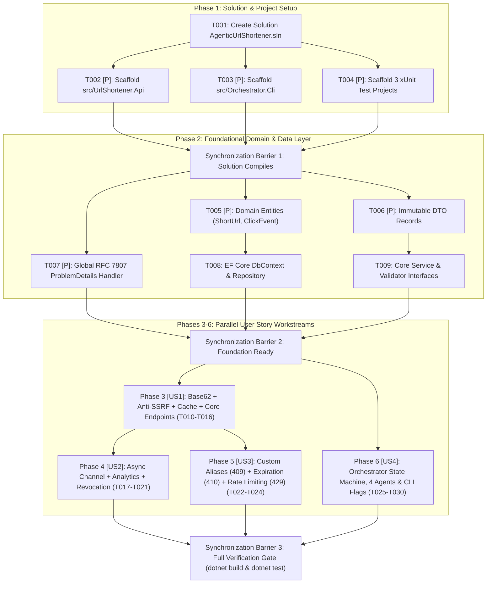

# Tasks: Enterprise Agentic URL Shortener & SDLC Orchestrator

**Branch**: `spec/tasks-md` | **Date**: 2026-11-04  
**Input**: Design documents from [`specs/`](./)  
**Prerequisites**: [`specs/constitution.md`](./constitution.md), [`specs/spec.md`](./spec.md), [`specs/plan.md`](./plan.md)  
**Organization**: Tasks are structured as an explicit **Non-Linear Dependency Graph (DAG)** grouped by phase and user story (`US1`–`US4`) with explicit Entry/Exit Gates and synchronization barriers.

---

## Format: `[ID] [P?] [Story?] Description`

- **`T001`–`T030`**: Unique, atomic engineering task identifier.
- **`[P]`**: **Parallelizable Task** — touches isolated files/modules and can execute concurrently within its wave prior to the phase's synchronization barrier.
- **`[US1]`–`[US4]`**: Maps directly to the prioritized User Stories in [`specs/spec.md`](./spec.md):
  - **`[US1]`**: Greenfield — Core URL Shortening, Anti-SSRF & Redirection (Priority: P1)
  - **`[US2]`**: Brownfield — Privacy-Safe Analytics & Link Revocation (Priority: P2)
  - **`[US3]`**: Ambiguous Requirements — Custom Aliases, Expiration & Rate Limiting (Priority: P2)
  - **`[US4]`**: Reusable Agentic SDLC Orchestrator CLI (`Orchestrator.Cli`) (Priority: P1)

---

## 🕸️ Non-Linear Dependency Graph & Synchronization Barriers

Unlike naive linear task chaining, our orchestration model executes independent workstreams in parallel waves and converges at strict synchronization barriers:

---

## Phase 1: Setup (Solution & Project Scaffolding)

**Purpose**: Initialize the .NET solution, source projects, and test suites with strict compiler and nullability guardrails.  
**Entry Gate**: Gate 2 (`specs/plan.md` & `specs/tasks.md`) approved by the human engineer.

- [x] **T001** Create `AgenticUrlShortener.sln` and root `Directory.Build.props` enforcing `<Nullable>enable</Nullable>`, `<ImplicitUsings>enable</ImplicitUsings>`, and `<TreatWarningsAsErrors>true</TreatWarningsAsErrors>`.
- [x] **T002** `[P]` Initialize web service project `src/UrlShortener.Api/UrlShortener.Api.csproj` with EF Core (`Sqlite`/`InMemory`) and OpenAPI references, plus `public partial class Program { }` for integration test visibility.
- [x] **T003** `[P]` Initialize console orchestrator project `src/Orchestrator.Cli/Orchestrator.Cli.csproj` with clean dependency injection and `Microsoft.Extensions.AI` abstraction support.
- [x] **T004** `[P]` Initialize the 3 automated test projects (`tests/UrlShortener.UnitTests`, `tests/UrlShortener.ContractTests`, and `tests/UrlShortener.SecurityTests`) referencing `xUnit` and `Microsoft.AspNetCore.Mvc.Testing`.

**🚦 Exit Gate (Synchronization Barrier 1)**: `dotnet build AgenticUrlShortener.sln` succeeds with 0 errors and 0 warnings.

---

## Phase 2: Foundational (Core Entities, DTOs & Error Infrastructure)

**Purpose**: Core building blocks that must complete before user story tracks diverge in parallel.  
**Entry Gate**: Synchronization Barrier 1 passed.

- [x] **T005** `[P]` Create domain entities `src/UrlShortener.Api/Domain/Entities/ShortUrl.cs` and `src/UrlShortener.Api/Domain/Entities/ClickEvent.cs` with concurrency tokens and indexed `ShortCode`.
- [x] **T006** `[P]` Create immutable C# `record` DTOs in `src/UrlShortener.Api/Domain/Contracts/` (`CreateShortUrlRequest.cs`, `ShortUrlResponse.cs`, `UrlMetadataResponse.cs`) strictly decoupled from database entities (OWASP API3 Anti-Mass Assignment).
- [x] **T007** `[P]` Implement `src/UrlShortener.Api/Infrastructure/Middleware/GlobalProblemDetailsExceptionHandler.cs` enforcing RFC 7807 `ProblemDetails` responses with correlation `traceId` on all unhandled errors.
- [x] **T008** Implement `src/UrlShortener.Api/Infrastructure/Data/UrlShortenerDbContext.cs`, `IUrlRepository.cs`, and `EfUrlRepository.cs` using parameterized queries and `.AsNoTracking()` for read queries (depends on `T005`).
- [x] **T009** Define SOLID domain service abstractions in `src/UrlShortener.Api/Services/` (`IBase62CodeGenerator.cs`, `IUrlSecurityValidator.cs`, `IIpPrivacyHasher.cs`, `IUrlShortenerService.cs`) (depends on `T005`, `T006`).

**🚦 Exit Gate (Synchronization Barrier 2)**: Foundation compiles cleanly; parallel tracks (`US1` and `US4`) are unblocked.

---

## Phase 3: User Story 1 — Greenfield: Core URL Shortening, Anti-SSRF & Redirection (Priority: P1) 🎯 MVP

**Goal**: Deliver the complete Greenfield URL Shortener MVP with cryptographic Base62 generation, Anti-SSRF protection, sub-50ms cached redirection, and health probes.  
**Entry Gate**: Synchronization Barrier 2 passed.

### Implementation for User Story 1
- [x] **T010** `[P]` `[US1]` Implement `src/UrlShortener.Api/Services/Base62CodeGenerator.cs` using `System.Security.Cryptography.RandomNumberGenerator` to generate 7-character `[0-9a-zA-Z]` codes.
- [x] **T011** `[P]` `[US1]` Implement `src/UrlShortener.Api/Services/UrlSecurityValidator.cs` enforcing `https://` scheme whitelist, 2,048-char limit, self-loop rejection, and Anti-SSRF blocking of loopback (`127.0.0.0/8`, `::1`, `localhost`), RFC 1918 private IPs (`10.0.0.0/8`, `172.16.0.0/12`, `192.168.0.0/16`), and cloud metadata (`169.254.169.254`).
- [x] **T012** `[US1]` Implement core shortening and cached resolution in `src/UrlShortener.Api/Services/UrlShortenerService.cs` with `IMemoryCache` hot lookup and bounded 3-attempt collision retry (`503 Service Unavailable` on exhaustion) (depends on `T008`, `T010`, `T011`).
- [x] **T013** `[US1]` Implement Greenfield Minimal API routes in `src/UrlShortener.Api/Endpoints/UrlEndpoints.cs` (`POST /api/v1/urls` returning `201 Created` with `Location`, `GET /{shortCode}` returning `302 Found` with `Cache-Control: no-store, no-cache`, and `GET /health` returning `200 OK`) (depends on `T012`).

### Automated Tests for User Story 1
- [x] **T014** `[P]` `[US1]` Write unit tests in `tests/UrlShortener.UnitTests/Base62AndValidationTests.cs` verifying 7-char Base62 distribution, collision retry exhaustion (`503`), and boundary validation.
- [ ] **T015** `[P]` `[US1]` Write OpenAPI contract tests in `tests/UrlShortener.ContractTests/GreenfieldContractTests.cs` verifying `201 Created`, `302 Found` (`no-store`), `404 Not Found`, and `/health` payload schemas.
- [ ] **T016** `[P]` `[US1]` Write Anti-SSRF security tests in `tests/UrlShortener.SecurityTests/SsrfAndSchemeSecurityTests.cs` verifying 100% rejection of loopback, RFC 1918, `169.254.169.254`, `javascript:`, and `file:` URIs.

**🚦 Exit Gate**: User Story 1 (Greenfield MVP) builds and passes all unit, contract, and SSRF security tests independently.

---

## Phase 4: User Story 2 — Brownfield: Privacy-Safe Analytics & Link Revocation (Priority: P2)

**Goal**: Evolve the Greenfield codebase (Brownfield scenario) by adding non-blocking click analytics and soft-delete link revocation without breaking existing redirection.  
**Entry Gate**: Phase 3 (`US1`) completed; Brownfield impact analysis verified against [`specs/plan.md`](./plan.md).

### Implementation for User Story 2
- [ ] **T017** `[P]` `[US2]` Implement `src/UrlShortener.Api/Services/IpPrivacyHasher.cs` computing salted SHA-256 hex digests so raw client IP addresses are never stored in plain text.
- [ ] **T018** `[P]` `[US2]` Implement `src/UrlShortener.Api/Infrastructure/Analytics/ClickAnalyticsBackgroundService.cs` consuming from a singleton bounded `Channel<ClickEvent>` and persisting analytics asynchronously in the background.
- [ ] **T019** `[US2]` Extend `UrlShortenerService.cs` and `UrlEndpoints.cs` to publish non-blocking `ClickEvent` messages on redirect, serve `GET /api/v1/urls/{shortCode}` (`200 OK` metadata & unique visitor counts), and handle `DELETE /api/v1/urls/{shortCode}` (`204 No Content` soft revocation + cache invalidation, causing subsequent redirects to return `410 Gone`) (depends on `T017`, `T018`).

### Automated Tests for User Story 2
- [ ] **T020** `[P]` `[US2]` Write unit tests in `tests/UrlShortener.UnitTests/PrivacyAndAnalyticsTests.cs` verifying salted SHA-256 IP hashing determinism and non-blocking channel queueing.
- [ ] **T021** `[P]` `[US2]` Write brownfield contract tests in `tests/UrlShortener.ContractTests/BrownfieldAnalyticsAndRevocationTests.cs` verifying `GET /api/v1/urls/{shortCode}` click/unique-visitor counts, `DELETE /api/v1/urls/{shortCode}` (`204 No Content`), and `410 Gone` on revoked links with zero regression to `US1`.

**🚦 Exit Gate**: Both Greenfield (`US1`) and Brownfield (`US2`) suites pass 100%.

---

## Phase 5: User Story 3 — Ambiguous Requirements: Custom Aliases, Expiration & Rate Limiting (Priority: P2)

**Goal**: Implement the normalized rules derived from `/speckit.clarify` (custom aliases with `409 Conflict`, UTC expiration returning `410 Gone`, and per-IP rate limiting returning `429 Too Many Requests`).  
**Entry Gate**: Phase 3 (`US1`) completed.

### Implementation for User Story 3
- [ ] **T022** `[P]` `[US3]` Enhance `UrlSecurityValidator.cs` and `UrlShortenerService.cs` to enforce custom alias regex (`^[a-zA-Z0-9_-]{4,32}$`), reserved-word blocklist (`api`, `health`, `admin`, `swagger`, `metrics`), immediate `409 Conflict` on duplicate custom aliases, and future UTC `expiresAt` validation (`410 Gone` when expired).
- [ ] **T023** `[US3]` Configure ASP.NET Core Rate Limiting middleware in `src/UrlShortener.Api/Program.cs` enforcing 10 req/min on `POST /api/v1/urls` and 100 req/min on `GET /{shortCode}` per client IP, returning HTTP `429 Too Many Requests` with `Retry-After: 60` and RFC 7807 `ProblemDetails`.

### Automated Tests for User Story 3
- [ ] **T024** `[P]` `[US3]` Write security and boundary tests in `tests/UrlShortener.SecurityTests/RateLimitAndAliasConflictTests.cs` verifying `409 Conflict` on duplicate custom aliases, `400 Bad Request` on reserved words/past expiration dates, `410 Gone` on expired links, and `429 Too Many Requests` with `Retry-After` header when rate limits are exceeded.

**🚦 Exit Gate**: All URL Shortener requirements (`FR-001`–`FR-015`) pass 100% of unit, contract, and security tests.

---

## Phase 6: User Story 4 — Reusable Agentic SDLC Orchestrator CLI (`Orchestrator.Cli`) (Priority: P1 — Critical Differentiator)

**Goal**: Build the standalone, domain-agnostic C# SDLC Orchestrator CLI demonstrating non-linear DAG execution, human approval checkpoints, bounded retries ($\le 3$) with Git rollback, dynamic re-planning, telemetry reporting, and workspace-reusable CLI flags.  
**Entry Gate**: Synchronization Barrier 2 passed (can execute in parallel with Phases 3–5).

### Implementation for User Story 4
- [ ] **T025** `[P]` `[US4]` Implement core engine components in `src/Orchestrator.Cli/Engine/`:
  - `SdlcStateMachine.cs` (non-linear state transitions & interactive human gates `[A]pprove / [R]eject / [S]afe-Stop`)
  - `DependencyGraphExecutor.cs` (executes parallel `[P]` task waves and waits at synchronization barriers)
  - `GitSnapshotManager.cs` (captures pre-execution Git checkpoints and executes automatic rollback)
  - `TelemetryTracker.cs` (tracks Task Success Rate, Retry/Rollback Frequency, MTTR, and Stage Latency)
- [ ] **T026** `[P]` `[US4]` Implement the 4 specialized C# agents in `src/Orchestrator.Cli/Agents/`:
  - `RequirementNormalizerAgent.cs` (ambiguity detection & spec synthesis)
  - `BrownfieldAnalyzerAgent.cs` (repository file/endpoint impact scanner)
  - `TaskDecomposerAgent.cs` (DAG builder & dynamic downstream re-planner on gate rejection or upstream change)
  - `VerificationAndRollbackAgent.cs` (runs `dotnet build`/`dotnet test` with $\le 3$ bounded self-correction retries and rollback)
- [ ] **T027** `[US4]` Implement scenario runners and reusable CLI flags in `src/Orchestrator.Cli/Scenarios/` and `Program.cs`:
  - Interactive Zero-Config Evaluation Mode for **Greenfield**, **Brownfield**, and **Ambiguous** scenarios (plus live LLM routing when API keys are configured)
  - Reusable CLI flags (`--workspace <path>`, `--init`, `--verify`) for scaffolding and governing any repository in the workspace (depends on `T025`, `T026`).

### Automated Tests for User Story 4
- [ ] **T028** `[P]` `[US4]` Write unit tests in `tests/UrlShortener.UnitTests/OrchestratorStateMachineTests.cs` verifying non-linear DAG ordering, parallel wave grouping, dynamic downstream re-planning on `[R]eject`, bounded retry counting ($\le 3$), automatic rollback trigger on 3rd failure, and MTTR telemetry calculations.

**🚦 Exit Gate (Synchronization Barrier 3)**: Full solution (`UrlShortener.Api`, `Orchestrator.Cli`, and all 3 test suites) builds with 0 warnings/errors and passes 100% of tests.

---

## Phase 7: Polish, Cross-Artifact Verification & Final Engineering Summary

**Purpose**: Final end-to-end validation, documentation alignment, and release readiness (Gate 3).  
**Entry Gate**: Synchronization Barrier 3 passed.

- [ ] **T029** `[P]` Execute full test suite with code coverage collection (`dotnet test --collect:"XPlat Code Coverage"`) to verify $\ge 80\%$ coverage across domain and API modules (`SC-002`).
- [ ] **T030** Generate the **Final Engineering Summary** in `README.md` / `specs/` documenting architecture overview, scenario walkthroughs, validation results, reliability metrics, assumptions, limitations, and trade-offs.

---

## 🔍 Cross-Artifact Consistency Analysis (`/speckit.analyze`)

In accordance with Phase 7 (`analyze`) of the GitHub Spec Kit lifecycle, the traceability matrix below verifies 100% bidirectional alignment across all 4 specification artifacts with zero drift:

| Requirement ID | Constitutional Rule | Spec Scenario (`specs/spec.md`) | Architecture Component (`specs/plan.md`) | Task IDs (`specs/tasks.md`) | Verification Test Suite |
| :--- | :--- | :--- | :--- | :--- | :--- |
| **`FR-001`, `FR-003`, `FR-004`** | Domain Rule 1 (Base62 & 3 Retries) | `US1` (Greenfield) | `Base62CodeGenerator`, `UrlShortenerService`, `ADR-001` | `T010`, `T012`, `T013` | `UnitTests`, `ContractTests` (`T014`, `T015`) |
| **`FR-002`** | Principle 4 & Domain Rule 2 (Anti-SSRF) | `US1` (Greenfield) | `UrlSecurityValidator` | `T011`, `T016` | `SecurityTests` (`T016`) |
| **`FR-005`** | Domain Rule 1 (Custom Alias & `409`) | `US3` (Ambiguous) | `UrlSecurityValidator`, `UrlShortenerService` | `T022`, `T024` | `SecurityTests` (`T024`) |
| **`FR-006`** | Domain Rule 3 & 5 (`302 Found`, `<50ms`) | `US1` (Greenfield) | `IMemoryCache`, `UrlEndpoints`, `ADR-002` | `T012`, `T013` | `ContractTests` (`T015`) |
| **`FR-007`, `FR-008`** | Domain Rule 5 (`Channel<ClickEvent>`, SHA-256 IP) | `US2` (Brownfield) | `IpPrivacyHasher`, `ClickAnalyticsBackgroundService`, `ADR-003` | `T017`, `T018`, `T019` | `UnitTests` (`T020`) |
| **`FR-009`, `FR-010`, `FR-011`, `FR-012`** | Domain Rule 3 (Analytics, Revocation, `410`/`404`) | `US2` & `US3` | `UrlShortenerService`, `UrlEndpoints` | `T019`, `T021`, `T022` | `ContractTests` (`T021`), `SecurityTests` (`T024`) |
| **`FR-013`** | Domain Rule 4 (Rate Limiting `429`) | `US3` (Ambiguous) | Rate Limiting Middleware (`Program.cs`) | `T023`, `T024` | `SecurityTests` (`T024`) |
| **`FR-014`, `FR-015`** | Principle 6 (RFC 7807 `ProblemDetails` & `/health`) | `US1`–`US3` | `GlobalProblemDetailsExceptionHandler`, `UrlEndpoints` | `T007`, `T013` | `ContractTests` (`T015`) |
| **`FR-016`** | Principle 2 & Domain Rule 6 (Orchestrator CLI) | `US4` (Orchestrator) | `SdlcStateMachine`, 4 Agents, `ADR-004` | `T025`, `T026`, `T027` | `UnitTests` (`T028`) |
